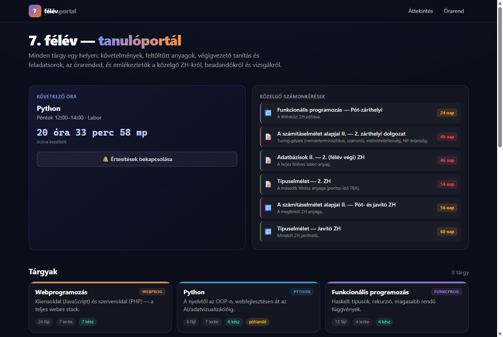
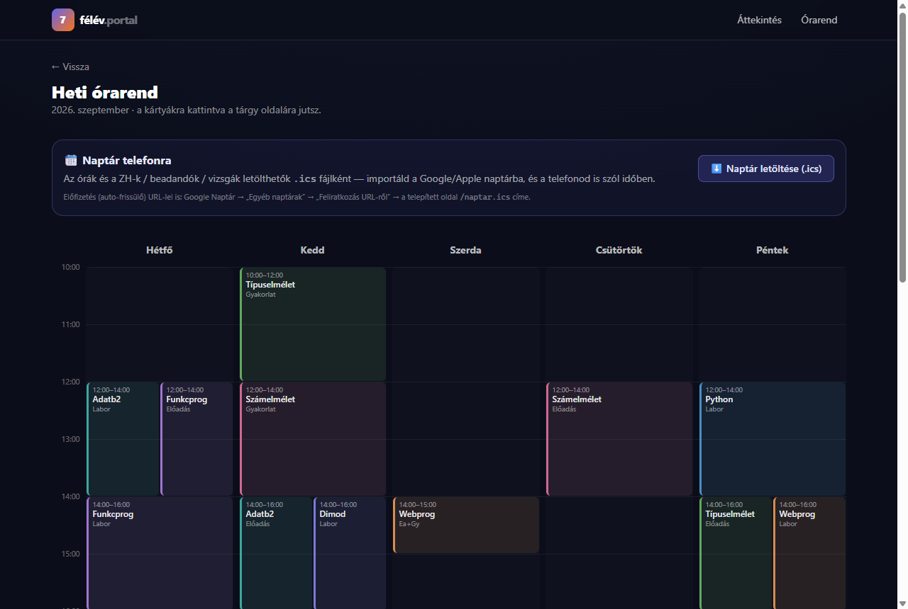
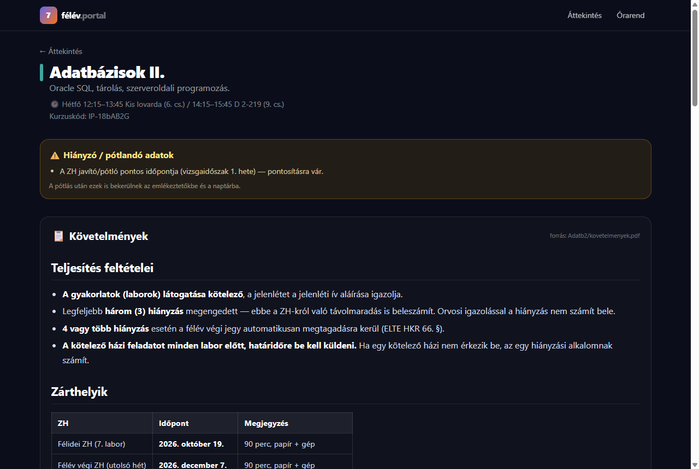
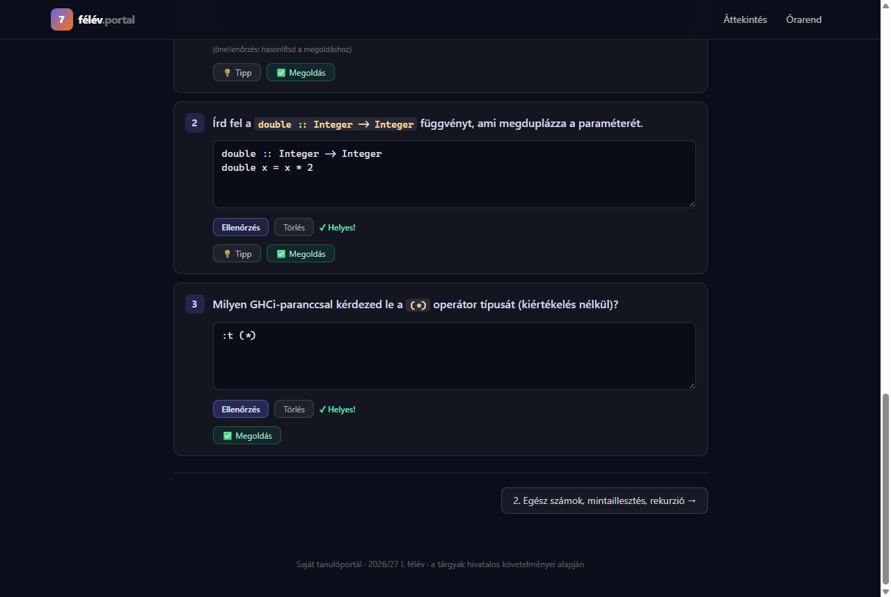

# Semester Study Portal

[](https://github.com/ttomi2254/7-felev/actions/workflows/ci.yml)

A personal study portal I built for my 7th university semester. It brings all my courses into one place: requirements, step-by-step lessons with self-checking exercises, the weekly timetable, exam countdowns and a calendar feed I can subscribe to on my phone.

**Live:** https://7-felev.vercel.app · The UI and content are in Hungarian.

## Features

- **Course pages** with requirements, grading rules, a list of course files and upcoming assessments for 8 courses.
- **Lessons with exercises.** 55 lessons written in Markdown. Many exercises can be checked automatically: you type your answer and get instant feedback. There are three ways of checking: normalized text, whitespace-insensitive code and numbers with a small tolerance. Exercises also have optional hints and solutions, and Agda exercises have a Unicode symbol palette.
- **Dashboard** with a live countdown to the next class and a list of upcoming exams with days remaining. You can turn on browser notifications for them.
- **Weekly timetable** shown as a grid.
- **Calendar feed** (`/naptar.ics`). It follows the iCalendar standard (RFC 5545): classes repeat weekly until the end of the semester, exams have reminders the day before and an hour before, and the time zone is Europe/Budapest. It works with Google and Apple Calendar, either imported or subscribed to by URL.

## Tech stack

| | |
|---|---|
| Framework | Next.js 15 (App Router) + React 19, fully statically generated (70 pages) |
| Language | TypeScript (strict) |
| Styling | Tailwind CSS |
| Content | Typed data modules (`data/subjects/*.ts`) with Markdown rendered by `react-markdown` + `remark-gfm` |
| Tests | Vitest |
| CI | GitHub Actions: lint → type check → unit tests → production build |
| Hosting | Vercel |

Some lesson sets are written as separate Markdown files and compiled into a data module by a small Python script (`scripts/adatb2-zh1/gen.py`).

## Testing

`npm test` runs 59 unit tests in five groups:

- **Calendar export (`lib/ics.ts`).**
  - Line folding at 75 *octets*, not characters, without splitting multi-byte characters.
  - Escaping of text values, CRLF line endings and balanced `BEGIN`/`END` blocks.
  - Unique UIDs, every event ending after it starts, and weekly recurrence that stops at the end of the semester.
  - Parsing times out of free-text fields.
- **Date logic (`lib/events.ts`).** Day differences across the daylight-saving changes (the 25-hour day on 25 Oct 2026 and the 23-hour day on 28 Mar 2027) and the boundaries of the Hungarian relative dates ("today", "tomorrow", "next week"). The tests always run in the `Europe/Budapest` time zone so the results are the same on any machine.
- **Answer checking (`lib/answer.ts`).** Each checking mode, comma and dot as the decimal separator, the numeric tolerance and inputs that aren't numbers.
- **Content integrity.**
  - Course and lesson slugs are unique and URL-safe, event dates are real calendar dates, and the timetable only uses known courses with valid times.
  - The correct answer of every checkable exercise passes its own checker.
  - An input's placeholder never gives away the answer.
- **Material links.** A course file gets a link only if it's actually part of the deployed site.

### Bugs the tests found

1. **Over-long calendar lines.** The folding function counted UTF-16 characters instead of UTF-8 bytes, so Hungarian accents and emoji pushed **19 lines** of the real calendar over the RFC 5545 limit. It now folds by bytes, one code point at a time.
2. **Lost end times.** `extractTimes("9:00–10:30")` dropped the end time, because the two times were compared as strings *before* zero-padding ("10:30" < "9:00"), so the event fell back to a default length. No current event uses a one-digit hour, so this was a hidden bug waiting for new data.
3. **Placeholders gave away the answers.** In **45 exercises** the input placeholder was the full correct answer, so the solution was visible before you typed anything. Multi-line placeholders now show only the type signature, and single-line ones fall back to the default prompt.
4. **Broken file links.** The course files aren't in the repository, so every link to them returned 404 on the live site. They're now checked at build time and shown without a link, labelled "local only".

### Maintenance

- Upgraded from Next.js 14 to 15.5 and React 19. The 14.x line no longer gets fixes for several published security advisories.
- Updated the code for the App Router's asynchronous route `params` in Next 15.
- Switched from the deprecated `next lint` to the ESLint CLI.

## Development

```bash
npm install
npm run dev        # http://localhost:3000
npm test           # unit tests
npm run lint
npm run typecheck
npm run build
```

## Screenshots

| Dashboard | Timetable |
|---|---|
|  |  |

| Course page | Self-checking exercises |
|---|---|
|  |  |

## Note on content

The original course materials (slides, PDFs, lab files) belong to the university and the instructors, so they aren't in this repository. Instructor contact details are left out of the public version, and so is the content of some courses.
